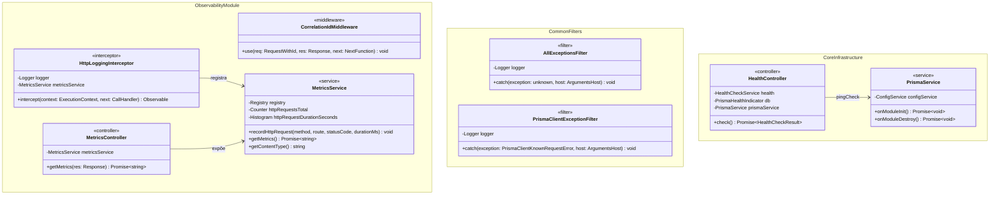

# UML — Diagrama de Classes: Infraestrutura Transversal e Observabilidade

Componentes globais de persistência, saúde da aplicação, tratamento de exceções e observabilidade (correlação, logging estruturado e métricas Prometheus).

