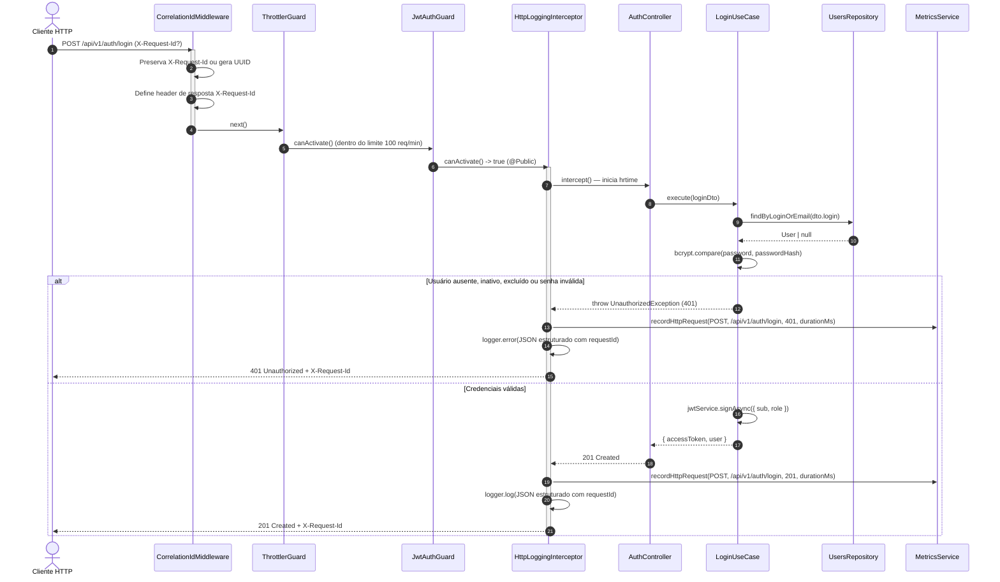
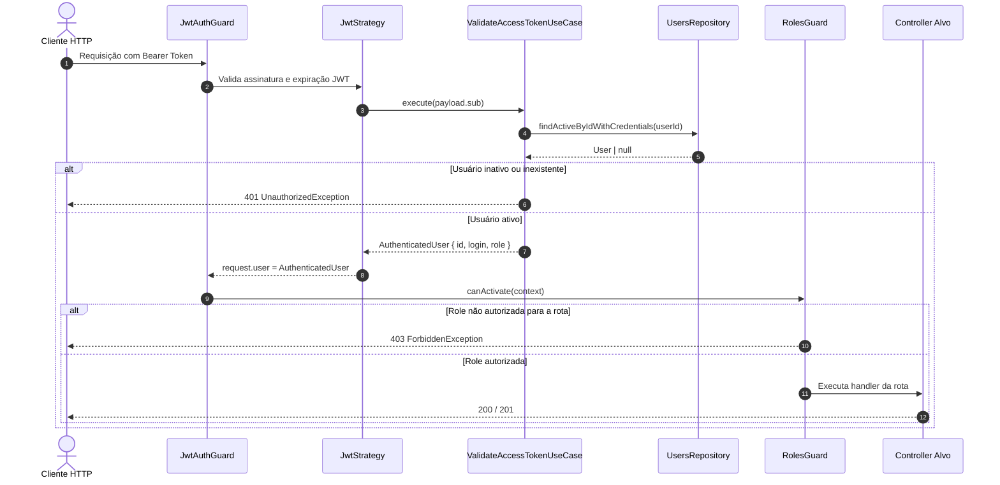

# UML — Sequência: Pipeline HTTP, Autenticação JWT e Observabilidade

Detalha o ciclo completo de uma requisição HTTP passando por correlação, rate limit, autenticação/RBAC, logging estruturado e métricas.

## 1. Login e Emissão de Token JWT

## 2. Validação de Rota Protegida (JWT + RBAC)

