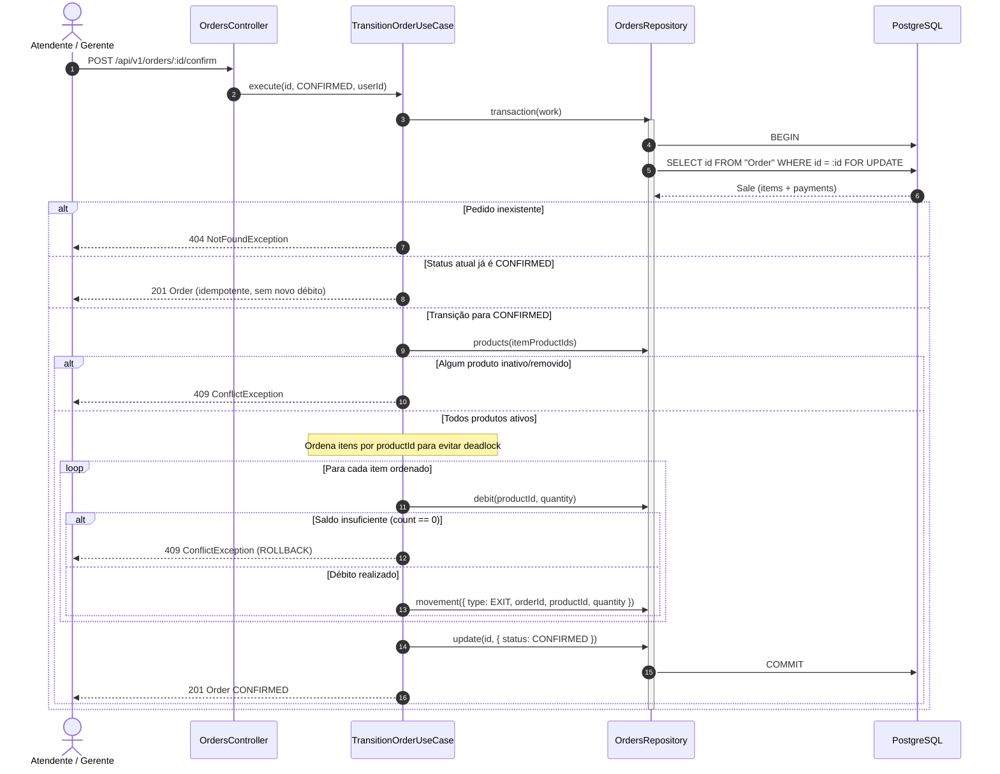
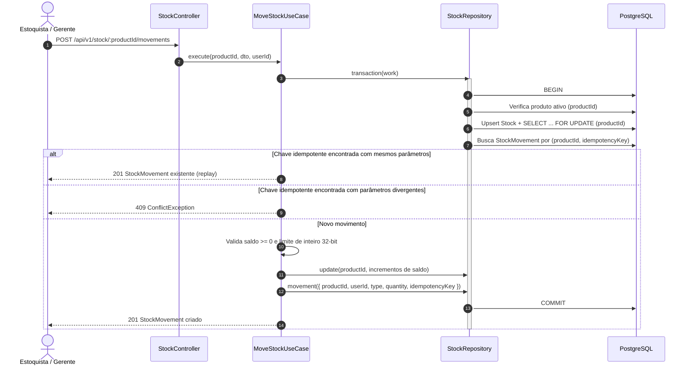

# UML — Sequência: Ciclo de Vida de Pedidos e Controle de Estoque

Detalha o controle transacional, bloqueio pessimista (`SELECT ... FOR UPDATE`), ordenação determinística anti-deadlock e idempotência de estoque.

## 1. Confirmação e Cancelamento de Pedido com Estoque

## 2. Movimentação Idempotente de Estoque

