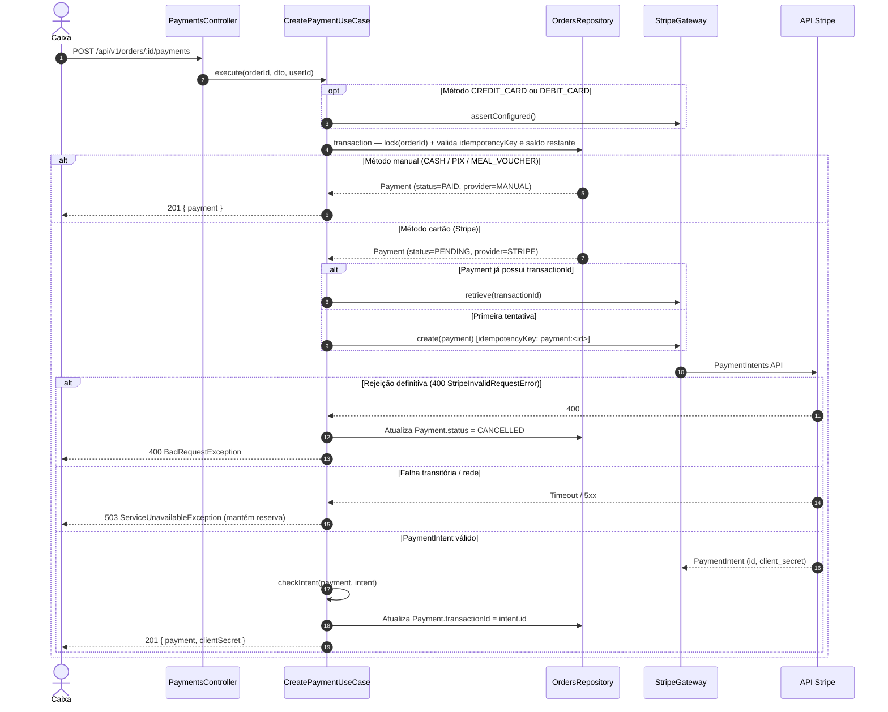
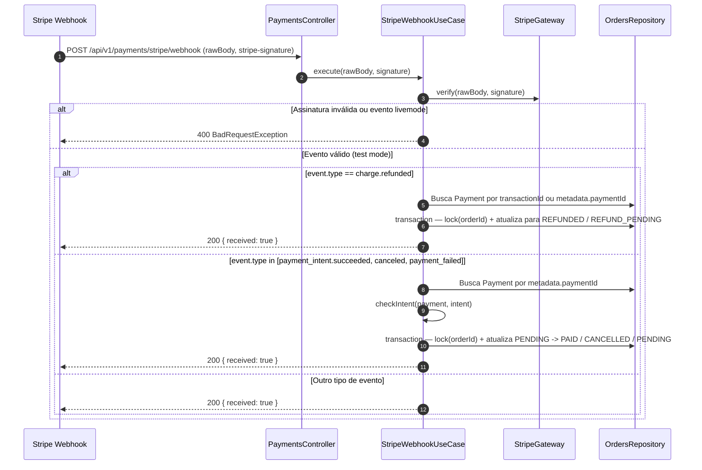

# UML — Sequência: Pagamentos, Estornos e Reconciliação Stripe

Detalha o fluxo síncrono de criação/estorno de pagamentos e o processamento assíncrono de webhooks assinados pelo Stripe.

## 1. Registro de Pagamento (Manual vs Cartão Stripe)

## 2. Reconciliação Assíncrona via Stripe Webhook

