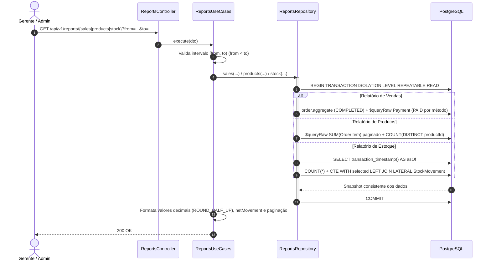
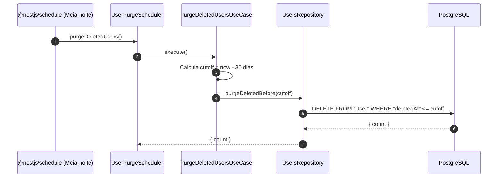

# UML — Sequência: Relatórios Consistentes e Rotina de Purga

Detalha o isolamento transacional dos relatórios gerenciais e a rotina agendada de limpeza de usuários desativados.

## 1. Geração de Relatórios (`RepeatableRead`)

## 2. Rotina Agendada de Purga de Usuários

