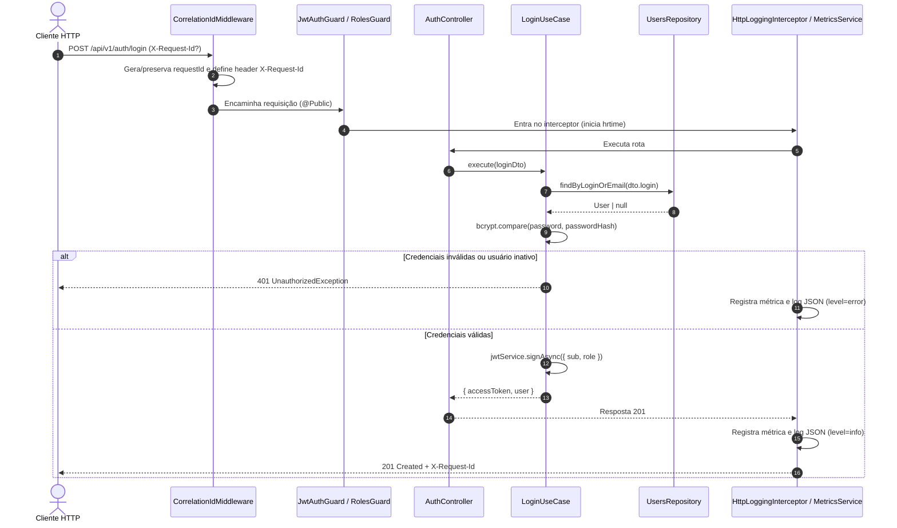
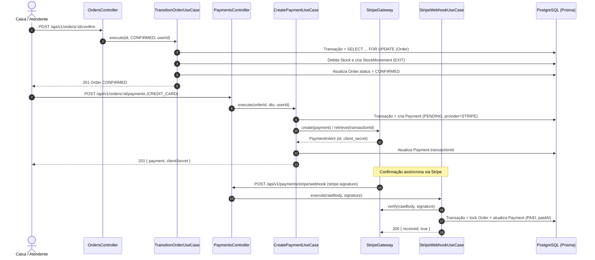
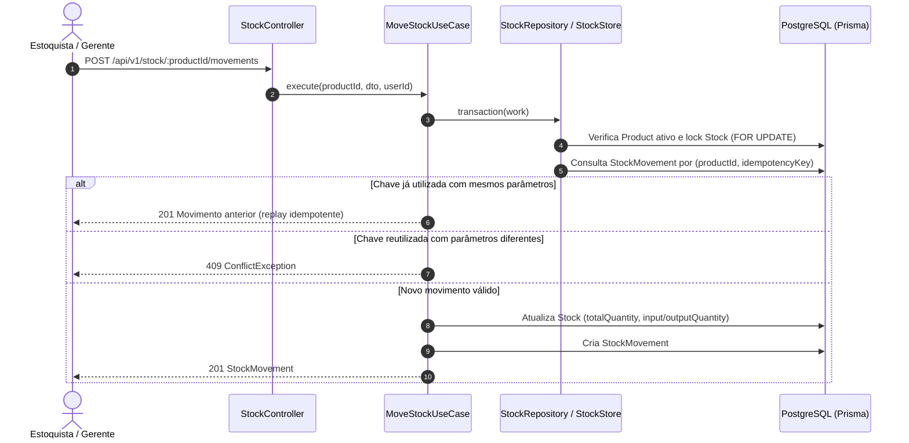

# Diagramas UML — Sequência

Principais fluxos de execução da **Food Service API**.

## 1. Autenticação JWT e Observabilidade HTTP

## 2. Criação, Confirmação e Pagamento com Stripe Webhook

## 3. Movimentação Idempotente de Estoque

